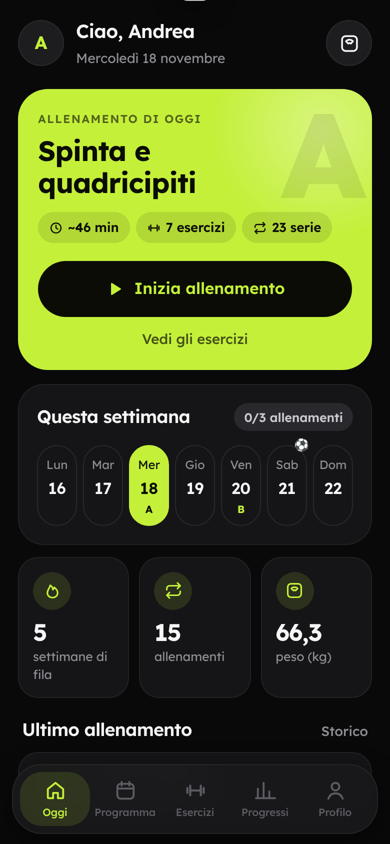
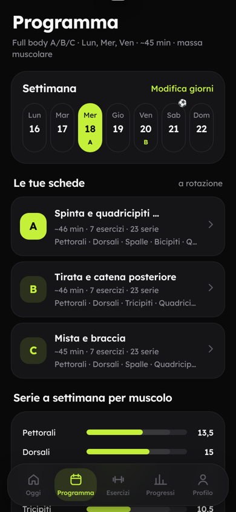
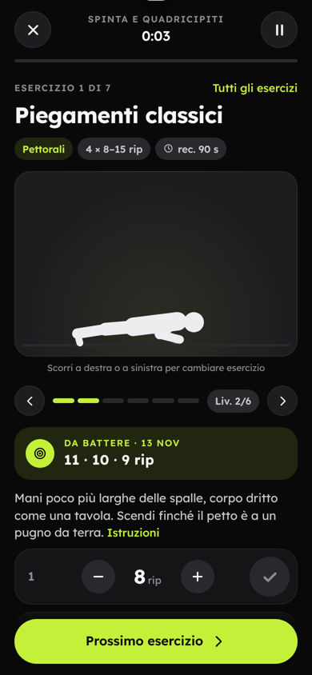
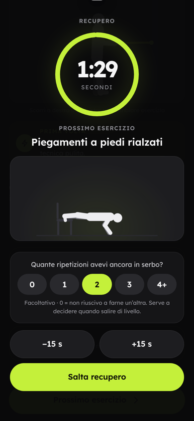
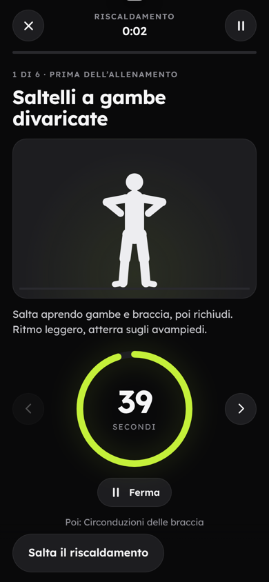
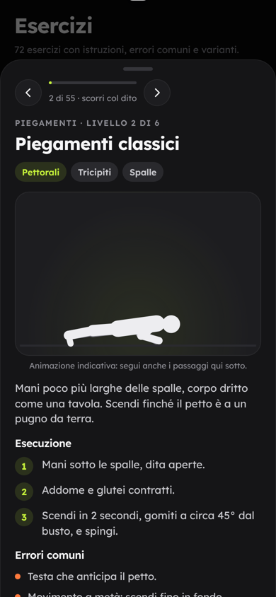
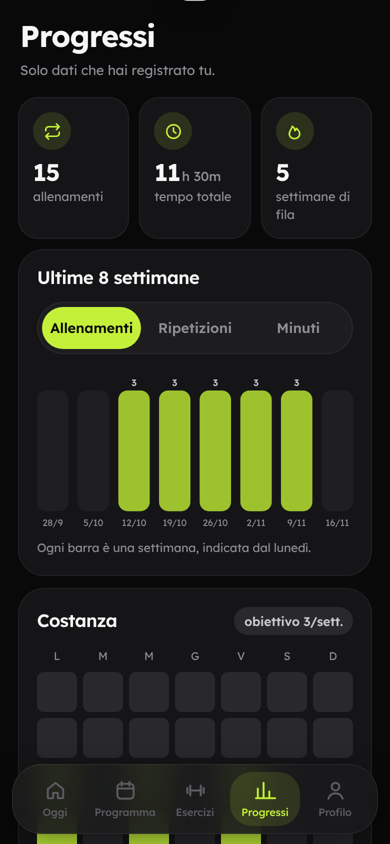

# Leva – Allenamento a casa

Web app installabile (PWA) per allenarsi a casa a corpo libero: crea un programma personalizzato, guida l'allenamento passo per passo e fa progredire gli esercizi in automatico. Funziona offline e i dati restano solo sul telefono.

**Prova l'app:** https://leva-allenamento.pages.dev

<p>




</p>
<p>



</p>

## Funzionalità

**Programma**
- Configurazione iniziale: obiettivo (massa, forza, resistenza, forma), livello, giorni (da 2 a 4), durata (30, 45 o 60 minuti), attrezzatura, zone da proteggere, giorni delle partite.
- Generatore automatico: full body ×2, full body A/B/C oppure parte alta/parte bassa. Sceglie solo esercizi possibili con l'attrezzatura disponibile, non ripete lo stesso movimento nella seduta e adatta il numero di esercizi e di serie alla durata.
- Volume settimanale per gruppo muscolare, sostituzione degli esercizi, modifica delle serie.
- Calendario a 4 settimane con allenamenti previsti a rotazione e partite per data (con rinvii): vicino alle partite gli esercizi per le gambe vengono alleggeriti.

**Allenamento**
- Riscaldamento e defaticamento guidati, con timer.
- Ogni esercizio ha un'animazione in loop: un omino SVG con cinematica inversa, funziona anche offline.
- Durante l'allenamento: "da battere" (risultato dell'ultima volta), timer di recupero ad anello, RIR facoltativo, cronometro per gli esercizi a tempo, peso dello zaino, pausa e ripresa anche dopo la chiusura dell'app.
- Guida vocale: conto alla rovescia e nome del prossimo esercizio.
- Per ogni esercizio: serie, ripetizioni, ritmo di ogni ripetizione (es. «scendi in 2 s · spingi in 1 s»), riposo e come eseguirlo per il proprio obiettivo; «Guidami il ritmo» scandisce le ripetizioni con voce e segnali.
- Blocco facoltativo per il collo (flessione, estensione, isometrie laterali, scrollate) a fine allenamento.
- Adattamento alla giornata: energia, gambe stanche e giorni vicini alle partite.
- Recuperi decisi dal programma in base al tipo di esercizio (multiarticolari 90 s, isolamento 75 s, core e polpacci 60 s, collo 45 s; 120 s con obiettivo forza), seguendo le evidenze sulla durata delle pause per l'ipertrofia (Singer et al., 2024). Durata stimata comprensiva di pause, riscaldamento e defaticamento.

**Progressione**
- Si sale di livello solo con tutte le serie al massimo del range e un margine (RIR ≥ 1). Senza RIR servono due allenamenti di fila.
- Dopo due sedute sotto il minimo viene proposta una variante più facile.
- Dopo 6 settimane costanti viene proposta una settimana di scarico.
- Prerequisiti chiari per gli esercizi avanzati.

**Progressi**
- Grafici settimanali, costanza, record personali, storico per esercizio.
- Peso con grafico e linea dell'obiettivo, IMC con le fasce dell'OMS, misure del corpo (braccio, petto, vita, coscia).

**Comodità**
- Libreria di oltre 70 esercizi con ricerca, filtri, istruzioni, errori comuni, note di sicurezza e scorrimento laterale tra un esercizio e l'altro.
- Tasto indietro del telefono gestito passo per passo.
- Promemoria nel calendario (file `.ics` con eventi ricorrenti) e backup JSON condivisibile, con validazione all'importazione.

## Scelte tecniche

- **Nessun framework e nessuna build.** HTML, CSS e JavaScript puro, divisi per responsabilità. I file statici sono pubblicati su Cloudflare Pages a ogni commit su `main`.
- **Offline first.** Un service worker con strategia "prima la rete" mette in cache solo i file dell'app; i dati stanno in `localStorage`. Anche il font (Lexend) è salvato in locale.
- **Dati con ID stabili.** Esercizi e slot delle schede hanno ID che non cambiano mai: storico e progressione restano validi anche se cambiano nomi, ordine o programma. La migrazione dal formato v1 non tocca mai i dati originali.
- **Animazioni procedurali.** Ogni posa indica dove devono stare mani e piedi; un risolutore di cinematica inversa a due segmenti calcola gomiti e ginocchia, così gli arti mantengono sempre la loro lunghezza durante l'animazione.
- **Test automatici** sul motore (`node tests/run.js`), eseguiti da GitHub Actions a ogni push.

```
index.html            struttura della pagina
css/app.css           stile
fonts/lexend.woff2    font in locale
js/data.js            muscoli, attrezzatura, esercizi, schede, riscaldamento, migrazione v1
js/store.js           stato, salvataggio, migrazione e validazione dei dati
js/engine.js          programma, progressione, statistiche, IMC, scarico, partite, calendario
js/ui.js              icone, grafici SVG, componenti
js/anim.js            animazioni degli esercizi (cinematica inversa)
js/views.js           schermate
js/app.js             azioni, sessione, timer, voce, navigazione, gesti, avvio
sw.js                 service worker
tests/run.js          test automatici
```

## Dati (`localStorage`, chiave `leva.v2`)

| Campo | Contenuto |
|---|---|
| `profile` | nome, altezza, peso, obiettivo, `level`, `obj`, `wdays` (0 = lunedì), `dur`, `equip`, `avoid`, `excl`, `match` |
| `prog` | per ogni slot: `{ id, last, hits, low, load }`, dove `id` è l'esercizio attuale |
| `sessions` | `{ d, wid, wname, dur, vol, kg, check, ex: [{ s, k, x, reps, rir, u, load }], ups }` |
| `weights` / `measures` | `{ d, kg }` / `{ d, arm, chest, waist, thigh }` |
| `active` | allenamento in corso, compresa la fase (`warm`, `main` o `cool`) |
| `plan.over` | sostituzioni e serie modificate |
| `settings` / `meta` | preferenze; backup, scarico, avvisi già visti |

Regole: gli ID di esercizi (`ph_classic`…) e slot (`A1`…) non si cambiano e non si riutilizzano. La chiave `leva.v1` non viene mai modificata. A ogni rilascio si aggiorna `CACHE` in `sw.js`.

## Sviluppo

```
python3 -m http.server 8000      # poi apri http://localhost:8000
node tests/run.js                # test automatici, senza dipendenze
```

Leva fornisce indicazioni generali di allenamento e non sostituisce il parere di un medico.
